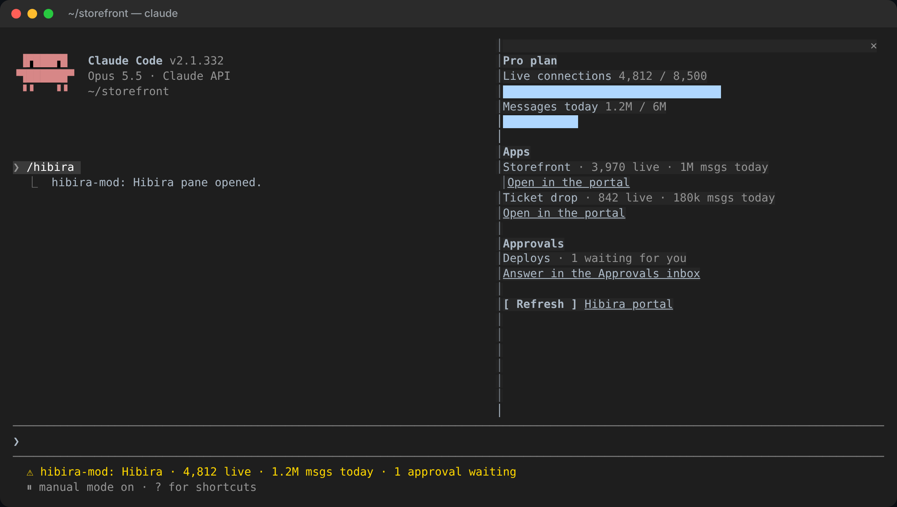
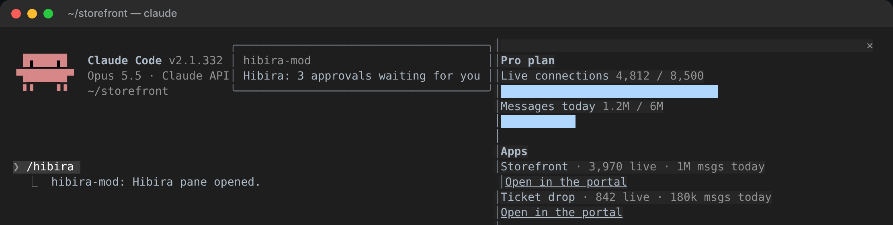

# Hibira mod for Claude Code

Keep an eye on your Hibira apps without leaving Claude Code. The mod adds a **Hibira pane** beside the chat and a **status line** under the prompt with your live connections, messages today and the approvals waiting for you. It reads your account through the [Hibira MCP server](https://hibira.io/mcp-server), so there is no API key to paste.



Scenarios and screenshots: [hibira.io/claude-code](https://hibira.io/claude-code)

## Scenarios

**Watch a launch while you ship fixes.** During a ticket drop or a flash sale, the status line shows `Hibira · 4,812 live · 1.2M msgs today` while you work. Open `/hibira` to see each app against your plan's connection and message limits, and catch a runaway loop before it eats the day's quota.

**Never leave an approval waiting.** When a teammate's deploy or a coding agent's risky command asks for a decision in [Hibira Approvals](https://hibira.io/approvals), a toast tells you `Hibira: 1 approval waiting for you`, and the pane links straight to the inbox.



**See what your agent just did.** After Claude publishes a test event, sends a push or creates an app through the Hibira MCP server, the pane refreshes on the spot, so you see the new message count without opening the portal.

**Know which app is busy.** The pane lists every app with its live connections and messages today, with a link to that app in the Hibira portal.

## Install

You need Claude Code 2.1.275 or later and the Hibira MCP server. Install the Hibira plugin first if you have not:

```sh
claude plugin marketplace add hibira-io/agent-plugin
claude plugin install hibira@hibira
```

Then run `/mcp` in Claude Code, pick `hibira` and sign in. A [Hibira connector on claude.ai](https://hibira.io/mcp-connectors) works too.

Install the mod. At the prompt of a terminal session:

```
/plugin install hibira-mod --marketplace hibira-io/claude-mod
```

From a shell:

```sh
claude plugin install hibira-mod --marketplace hibira-io/claude-mod
```

In the desktop app: click **+** next to the prompt box, then **Plugins**, **Add marketplace** with `hibira-io/claude-mod`, then **Add plugin**.

## Use

| What | How |
|---|---|
| Open the pane | `/hibira` |
| Status line | Shown on its own once the Hibira MCP server is connected, refreshed every minute |
| Refresh now | The **Refresh** button in the pane |
| New approval | A toast when the number of approvals waiting for you goes up |

The pane is read only: it calls `get_account`, `list_apps` and the Approvals workspace list (`api_get /approvals/workspaces`) on the Hibira MCP server. It changes nothing in your account. If the server is not connected, the pane says how to connect it.

## Develop

```sh
claude plugin validate .
claude plugin test .
claude --plugin-dir .
```

`hooks/register.tsx` is the hooks module (pane, status line, `/hibira`), `hooks/hibira.ts` reads the MCP results, `types/index.d.ts` declares the pane's state and `tests/` holds the tests.

## License

MIT

---

## 中文摘要

這個 mod 會在 Claude Code 裡加上一個 **Hibira 面板**和一行**狀態列**，讓你不用離開編輯器就能看到即時連線數、今天的訊息量，還有等你審核的 Approvals。資料透過 Hibira MCP server 讀取，不用貼 API key。

情境：
- **上線活動時一邊修 bug 一邊看流量**：狀態列隨時顯示連線數與訊息量，`/hibira` 面板會顯示每個 app 離方案上限還有多少。
- **不漏掉任何審核**：同事的部署或 coding agent 的高風險指令送出審核時，會跳出提示，並且可以從面板直接進到收件匣。
- **馬上看到 agent 做了什麼**：Claude 透過 Hibira MCP 發送事件或推播之後，面板會立刻更新。
- **知道哪個 app 最忙**：列出每個 app 的連線數與訊息量，並附上 portal 連結。

安裝：先裝好 Hibira plugin 並在 `/mcp` 登入，再執行 `claude plugin install hibira-mod --marketplace hibira-io/claude-mod`。面板只會讀取資料，不會更動你的帳號。
